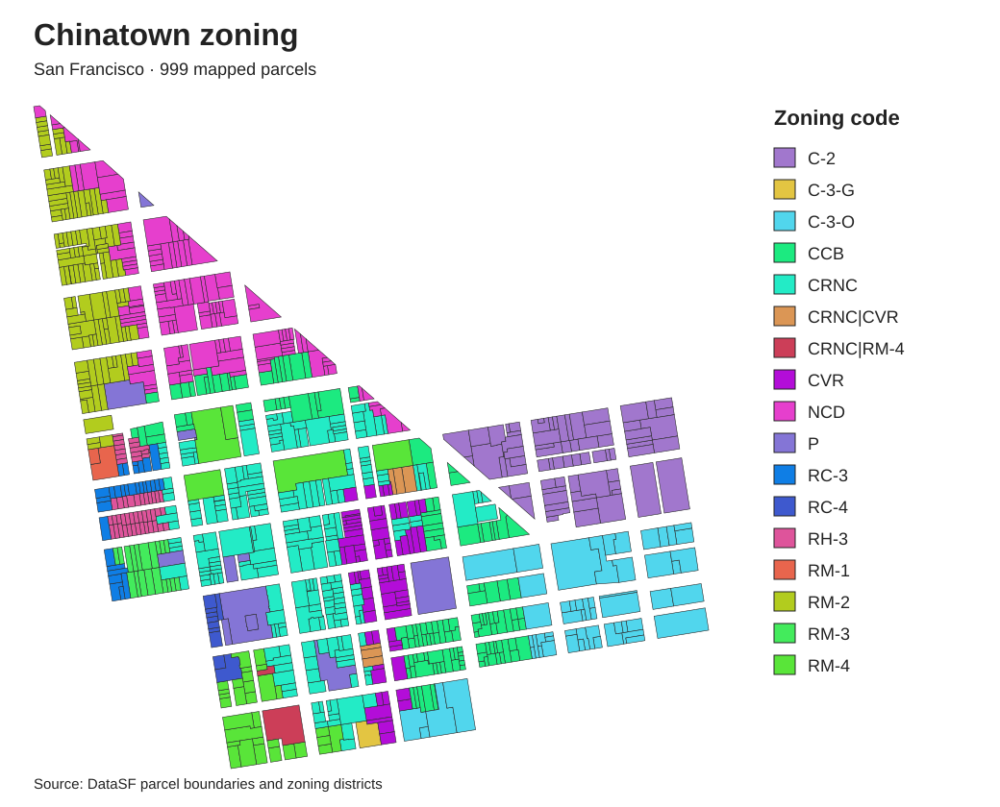
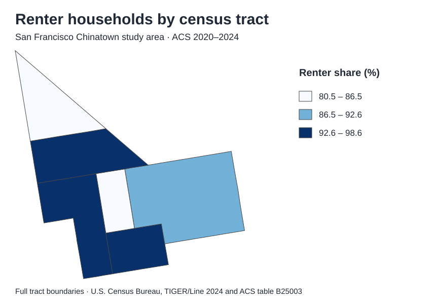

# Housing density and zoning in San Francisco’s Chinatown

Which zoning districts contain the most housing, and how concentrated is that housing on the land they occupy? This Python and GDAL pipeline links land-use records to parcel boundaries, zoning designations and Census tracts. It produces a parcel dataset for studying the existing housing stock and a tract dataset for interpreting household tenure.

## Geospatial data pipeline

| Stage | Operation | Check or output |
|---|---|---|
| Define the study area | Filter city land-use centroids against the DataSF Chinatown Analysis Neighborhood polygon. | 2,168 bounding-box candidates → 1,000 records inside the boundary. |
| Assign Census geography | Reproject TIGER/Line tract polygons and intersect them with the selected points. Join ACS tenure estimates on the 11-digit tract GEOID. | Each point matches one tract. All six tract IDs match the city’s independent Chinatown crosswalk. |
| Build the parcel layer | Link single-parcel land-use records to active parcel polygons through the city’s mapped parcel ID. Carry the zoning code and district name with each geometry. | 999 matched parcels. One multi-parcel record contributes nine units to the tract summary only. |
| Measure and summarize | Calculate parcel area in California Albers equal-area coordinates (EPSG:3310). Divide each district’s total units by its total mapped hectares. | [17 zoning categories](results/zoning_summary.csv) and [six tract summaries](results/tract_summary.csv). |

[Study-area evidence, sources, field definitions and zoning codebook](docs/data-guide.md)

## Where the housing is

Chinatown Residential Neighborhood Commercial (CRNC) contains the most recorded units. Residential Mixed, High Density (RM-4) accommodates 1,120 units on 2.883 mapped hectares. Its observed density is **1.84 times** the CRNC density. The three RM-4 parcels with the most housing contain 508 units. Excluding their units and land reduces RM-4 density to 327.2 units per hectare, still 1.55 times the density across all CRNC parcels. These comparisons describe the housing stock under the recorded zoning designations. Estimating the effect of a zoning change would require historical zoning and development records.

| District | Mapped parcels | Housing units | Hectares | Units/ha |
|---|---:|---:|---:|---:|
| CRNC | 233 | 1,485 | 7.023 | 211.5 |
| RM-4 | 36 | 1,120 | 2.883 | 388.5 |
| CCB | 139 | 785 | 4.032 | 194.7 |
| NCD | 130 | 662 | 4.411 | 150.1 |
| RM-2 | 126 | 559 | 3.094 | 180.7 |

The table shows the five largest categories by housing-unit count. The map shows all mapped categories. [Explore the parcel geometries and attributes](results/chinatown_parcels.geojson).



## Who rents in the study tracts?

Across the six full tracts, the 2020–2024 American Community Survey (ACS) estimates **5,684 renter households out of 6,258 occupied housing units (90.83%)**. The tract percentages range from 80.45% to 98.62%. Tract 107.02 has both the lowest estimate and the widest approximate 90% margin of error (±19.77 percentage points). Each mapped percentage applies to a whole tract. Household tenure for an individual parcel cannot be inferred from its map color.



## Reproduce the results

Run from the repository root with Python 3 and GDAL’s `ogr2ogr` on your path, or QGIS installed in the default macOS location. The following commands use the committed inputs and parcel layer.

```bash
python3 analyze.py
python3 prepare_acs.py
python3 check_tract_ids.py
python3 join_tracts.py
python3 join_acs.py
python3 zoning_density.py
python3 tract_margins.py
python3 rm4_sensitivity.py
```

To rebuild the parcel polygons from DataSF, run the commands below after the tract join and ACS steps. These calls require internet access and curl. Live records can change. To refresh the original neighborhood and land-use snapshot as well, run `python3 fetch.py` before starting the pipeline. That replaces the saved snapshot.

```bash
python3 match_parcel_ids.py
python3 build_parcel_map.py
python3 zoning_density.py
```

A fresh clone of the analytical release reproduced both summary CSVs byte for byte. A second run retrieved all 999 parcel geometries and matched their published attributes by parcel ID. [Verified analytical revision](https://github.com/gojungle0420-maker/sfchinatown-landuse-housing/commit/13663ae).

To inspect the styled maps, open [the zoning project](chinatown_zoning.qgz) or [the tenure project](chinatown_renter_share.qgz) in QGIS from a full checkout. The projects use relative paths to the data in this repository.
