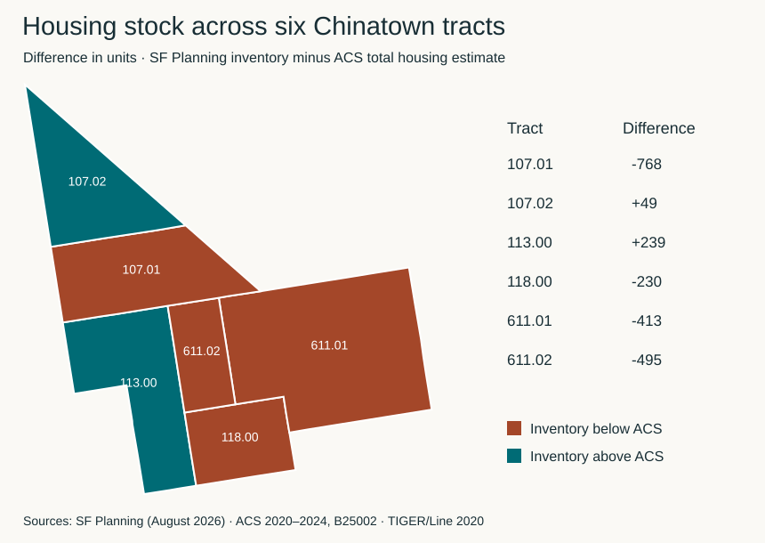

# Six-tract housing stock comparison

**[Open the interactive map](https://gojungle0420-maker.github.io/sfchinatown-landuse-housing/)**

Select a tract to compare the SF Planning housing inventory with ACS estimates for total, occupied and vacant housing units.

[Download the standalone map](https://raw.githubusercontent.com/gojungle0420-maker/sfchinatown-landuse-housing/main/results/tract_stock_validation.html) and open the saved HTML file in a browser for offline use. For GIS analysis, use the [GeoJSON boundaries and attributes](tract_stock_validation.geojson). For the numbers alone, open the [comparison table](tract_stock_validation.csv).
